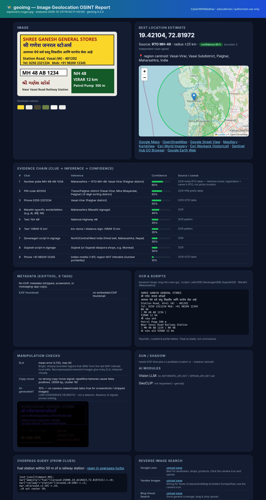
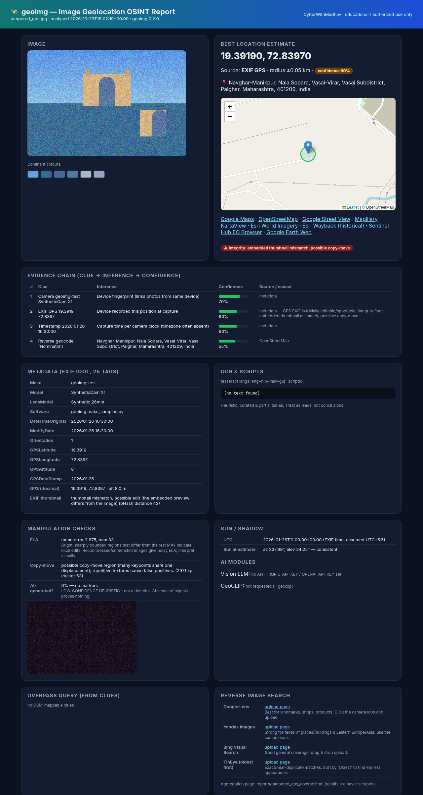
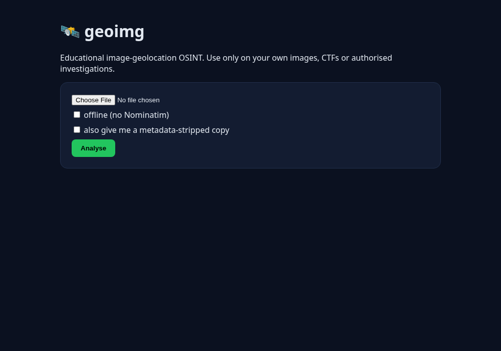

# geoimg — Image Geolocation OSINT Toolkit

> Educational / defensive OSINT tool by **CyberWithMadhav**. It works out *where a photo was taken* by combining metadata, text in the image (OCR), India-specific clues, manipulation checks and verification links. Every result is tied to the clue that produced it and given a confidence score.



## ⚖️ Ethics & legal note — read first

Geolocation can expose people's homes, routines and movements. **Only use geoimg on:**

- your own photos,
- CTF / training challenges (e.g. Trace Labs, GeoGuessr-style OSINT CTFs),
- authorised investigations (journalism verification, incident response, law-enforcement with legal process).

**Never** use it to stalk, harass, dox or track anyone. In India, misuse can fall under the **IT Act, 2000** (e.g. s.66C identity theft, s.66E privacy violation, s.72 breach of confidentiality) and the **Digital Personal Data Protection (DPDP) Act, 2023** (processing personal data without a lawful basis). Laws such as IPC/BNS stalking provisions (BNS s.78) also apply. Other countries have similar laws.

Design choices that follow from this:

- **No scraping.** Reverse image search is *links only* (Google Lens, Yandex, Bing, TinEye). geoimg never submits images automatically.
- **Public APIs used politely.** Nominatim: custom User-Agent, ≤1 req/s, on-disk cache. Overpass runs only when you pass `--run`, is rate-limited and has a timeout.
- **No hardcoded keys.** Optional services read env vars only.
- **Web UI binds to 127.0.0.1 only** and refuses other hosts.
- **`geoimg strip`** is included so people can *protect* their own photos.

## Features / modules

Every module lives in `geoimg/modules/`. Each is optional: if a dependency or key is missing it reports `skipped` with the reason and does not crash.

| # | Module | File | What it does |
|---|--------|------|--------------|
| 1 | Metadata + thumbnail check | `metadata.py` | EXIF/XMP via exiftool (Pillow fallback), DMS→decimal, camera, time, software. Compares the **embedded EXIF thumbnail with the main image (pHash)**; a mismatch suggests editing. |
| 2 | OCR + scripts | `ocr.py`, `colors.py` | Tesseract `eng+hin+mar+guj`, confidence-filtered, two page modes. Detects Unicode script (Latin/Devanagari/Gujarati/…) and Marathi-specific letters. Extracts dominant colours. |
| 3 | Evidence chain + map + PDF | `evidence.py`, `report.py` | Builds a clue → inference → confidence table and a best estimate with an uncertainty radius (boosted when independent clues agree). Shows a Leaflet map with a circle. Exports HTML, JSON and PDF. |
| 4 | India module | `india.py` | RTO plates (all state codes, MH-01…50, BH-series), PIN code prefixes, STD codes and +91 mobiles, NH/SH/railway/km-stone patterns, curated regional brands (**heuristic**). |
| 5 | Overpass generator | `overpass.py` | Turns clue words ("petrol pump", "railway station") into Overpass QL with an overpass-turbo link. Optional polite execution (`--run`). |
| 6 | Manipulation | `manipulation.py` | Error Level Analysis image, ORB copy-move (clone) detection, **low-confidence** AI-generated heuristic. |
| 7 | Reverse search page | `reverse_search.py` | Local aggregation page with Lens/Yandex/Bing/TinEye (oldest-first sort) links and instructions. No scraping. |
| 8 | Vision LLM | `vision_llm.py` | Optional landmark/region guess via `ANTHROPIC_API_KEY` or `OPENAI_API_KEY`. The model can be overridden with `GEOIMG_ANTHROPIC_MODEL` / `GEOIMG_OPENAI_MODEL`. |
| 9 | GeoCLIP | `geoclip_mod.py` | Optional `[geoclip]` extra. Top-k GPS predictions plus a heatmap. PIGEON is documented only (see roadmap). |
| 10 | Sun / shadow | `sun.py` | Uses astral. Checks a measured shadow azimuth/length against GPS+time, or scans latitudes when GPS is missing. |
| 11 | Verification links | `verify_links.py` | Google Maps/Street View, OSM, Mapillary (API only if `MAPILLARY_TOKEN` is set), KartaView, Esri imagery and Wayback, Sentinel Hub EO Browser, Google Earth. |
| 12 | Video | `video.py` | ffprobe location tag (ISO 6709) plus ffmpeg keyframes, with each keyframe run through the full pipeline. |
| – | Geocoding | `geocode.py` | Nominatim reverse and forward search with policy-compliant caching. |
| – | Strip | `strip.py` | Removes all metadata, or GPS only. |

## Install

Tested on Debian 13 / Python 3.13.

```bash
# system tools
sudo apt install -y libimage-exiftool-perl tesseract-ocr tesseract-ocr-eng \
    tesseract-ocr-hin tesseract-ocr-mar tesseract-ocr-guj tesseract-ocr-osd \
    ffmpeg fonts-noto-core
# optional: google-chrome or chromium for PDF/PNG rendering (weasyprint is the fallback)

git clone <your-fork-url> geoimg-osint && cd geoimg-osint
python3 -m venv .venv && . .venv/bin/activate
pip install -e ".[web,dev]"          # core + Flask UI + pytest
pip install -e ".[pdf]"              # optional: weasyprint fallback for PDF
```

**GeoCLIP (optional, pulls in PyTorch).** It's best kept in its own venv:

```bash
python3 -m venv ~/geoclip-venv
~/geoclip-venv/bin/pip install torch --index-url https://download.pytorch.org/whl/cpu
~/geoclip-venv/bin/pip install geoclip
export GEOIMG_GEOCLIP_PYTHON=~/geoclip-venv/bin/python   # or install geoclip into the main venv
```

**Optional environment variables** (none are required):

| Variable | Used for |
|---|---|
| `ANTHROPIC_API_KEY` / `OPENAI_API_KEY` | vision LLM guess |
| `GEOIMG_ANTHROPIC_MODEL` / `GEOIMG_OPENAI_MODEL` | override model name |
| `MAPILLARY_TOKEN` | Mapillary nearby-imagery API |
| `GEOIMG_GEOCLIP_PYTHON` | interpreter that has geoclip installed |
| `GEOIMG_CONTACT` | email added to the Nominatim User-Agent (recommended) |

## Usage

```bash
# Analyse one image, several, or a folder -> reports/<name>.json/.html (+ .pdf)
geoimg analyze photo.jpg -o reports --pdf
geoimg analyze samples/ -o reports
geoimg analyze photo.jpg --offline            # no network at all
geoimg analyze photo.jpg --no-llm --geoclip   # skip LLM, run GeoCLIP
geoimg analyze photo.jpg --overpass-run       # execute generated Overpass query
geoimg analyze photo.jpg --shadow-azimuth 300 --shadow-ratio 0.8 --utc-offset 5.5
geoimg analyze photo.jpg --public-url https://example.com/photo.jpg  # direct reverse-search links
geoimg analyze photo.jpg --json               # print JSON to stdout

# Privacy: strip metadata
geoimg strip photo.jpg -o photo_clean.jpg
geoimg strip photo.jpg --gps-only

# Video: keyframes through the pipeline
geoimg video clip.mp4 -o reports/clip

# Sun/shadow check
geoimg sun --datetime 2026-01-26T16:30:00 --lat 18.922 --lon 72.8347 --shadow-azimuth 70
geoimg sun --datetime 2026-01-26T16:30:00 --shadow-azimuth 70 --shadow-ratio 1.6   # latitude scan

# Overpass QL from clues
geoimg overpass "petrol pump" "railway station" --area Vasai-Virar
geoimg overpass "petrol pump" "railway station" --lat 19.38 --lon 72.83 --radius 1500 --within 300 --run

# Local web UI (http://127.0.0.1:5055)
geoimg web
```

## Screenshots

| Signboard, no GPS → located via RTO+PIN+STD | Gateway of India (GPS) |
|---|---|
|  |  |
| **Tampered image (thumbnail mismatch + clone)** | **Web UI / GeoCLIP heatmap** |
|  |   |

## Example results (synthetic test images in `samples/`)

- **gateway_gps.jpg**: EXIF GPS 18.9220, 72.8347 → Nominatim "Gateway of India, Apollo Bandar, Mumbai 400039". The sun check is consistent.
- **signboard_nogps.jpg**: no metadata. OCR reads MH 48 AB 1234, PIN 401202, STD 0250, NH 48, "VIRAR 12 km" plus Marathi/Gujarati text → **Vasai-Virar, ±25 km, 85% confidence** (three independent clues agree). Overpass query: *fuel station within 50 m of a railway station*.
- **tampered_gps.jpg**: EXIF thumbnail pHash distance 42 (mismatch), copy-move cluster detected → GPS confidence reduced to 60%.

## Tests

```bash
python tests/make_samples.py      # regenerate synthetic samples
pytest -q                         # offline tests (network mocked)
GEOIMG_NET=1 pytest -q -k live    # optional live Nominatim test
```

Each implemented module has at least one test (27 tests in total).

## Roadmap (done vs stubbed)

| Item | Status |
|---|---|
| EXIF/XMP, DMS conversion, Nominatim, map links, strip | ✅ done |
| Thumbnail pHash mismatch | ✅ done |
| OCR eng/hin/mar/guj + script detection | ✅ done |
| Evidence chain, Leaflet uncertainty map, PDF | ✅ done |
| India module (RTO, PIN, STD, roads, brands) | ✅ done. PIN uses a prefix/sorting-district table, not the full ~19k-office dataset |
| Overpass generator + optional execution | ✅ done |
| ELA, ORB copy-move, AI heuristic | ✅ done. The AI check is a heuristic, **not** a trained detector |
| Reverse-search aggregation page | ✅ done (links only, by design) |
| Vision LLM (Anthropic/OpenAI) | ✅ implemented, tested with mocks only (no key during development) |
| GeoCLIP | ✅ optional extra, tested with a CPU venv |
| PIGEON / PIGEOTTO | 📝 documented only. The weights and training setup are research-grade and too heavy for this tool |
| Sun/shadow (astral) | ✅ done. The shadow azimuth/ratio are measured by the user |
| Verification links (Mapillary/KartaView/Esri/Wayback/Sentinel) | ✅ links done. Mapillary API needs `MAPILLARY_TOKEN` |
| Video keyframes | ✅ done |
| Future | full India Post PIN dataset, automatic shadow measurement, a trained AI-image detector (C2PA/content-credentials check), language-model-free landmark matching with OSM POIs |

## Limitations

- OCR and India heuristics have been verified on **synthetic** images. Real photos (perspective, blur, stylised fonts) will need tuning.
- RTO/PIN/STD/brand tables are curated heuristics. They are leads, not proof. A vehicle's registration does not prove where it was photographed.
- GeoCLIP is weak on synthetic or indoor images and is only a coarse prior.
- The AI-generated check and ELA are indicators only. Absence of signals proves nothing.
- Nominatim and Overpass are free, rate-limited community services. Respect their usage policies, and self-host for heavy use.
- The Leaflet map tiles need internet. PDF rendering of the map needs Chrome/Chromium (the weasyprint fallback has no map).
- Messaging apps (WhatsApp etc.) strip EXIF, so most shared images rely on visual clues.

## License

MIT © 2026 Madhav Pandya. See [LICENSE](LICENSE).
